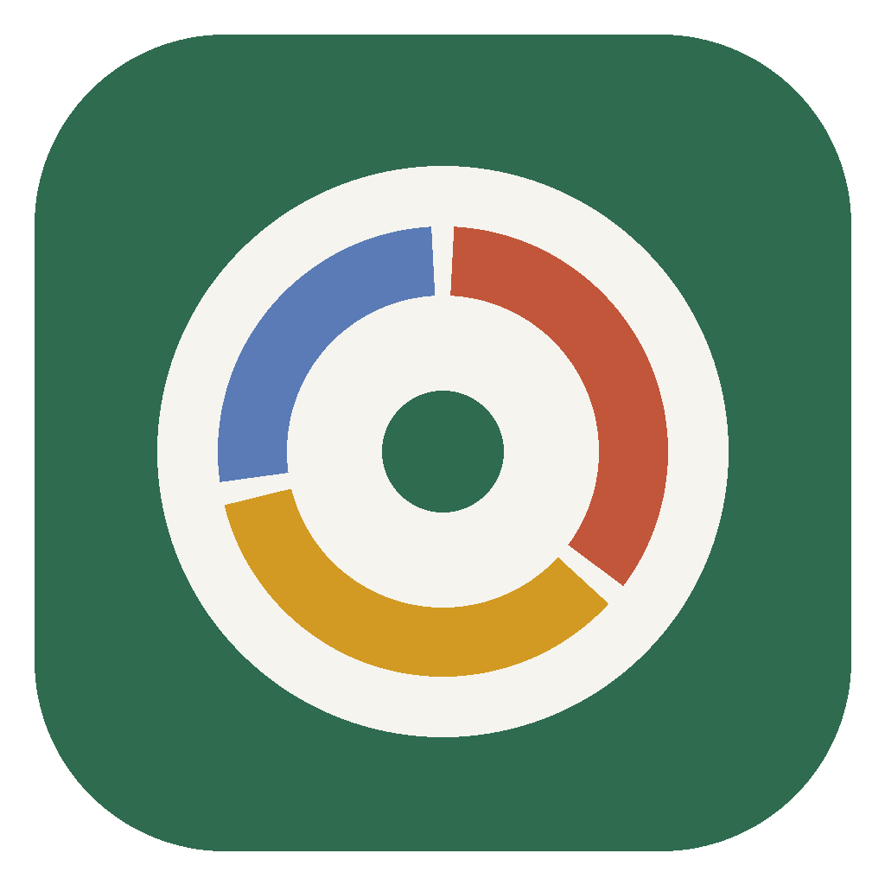

# MacroLog

A local-first macro tracker for macOS. Describe a meal in plain English, such as *"2 rotis, a bowl of dal, 150 g grilled chicken and a flat white"*. MacroLog splits it into foods and weights, matches each food against 16,000+ entries from official food-composition databases, and logs calories, protein, carbs, fat and fibre. Daily targets are based on published research and adapt each week to your measured weight trend.

All logs and settings are stored locally in a dedicated browser profile on your Mac. There is no server and no account.



## Features

- **Natural-language logging.** Claude parses free text into foods and gram weights. A second step picks the best database entry for each food, and you can review or change grams and matches before saving.
- **Grounded nutrition data.** 16,427 foods from Australian (AFCD Release 3, AUSNUT 2011–13), US (USDA SR28) and Indian (INDB) sources. AI estimates are used only when nothing matches, and they are labelled `EST`.
- **Offline search.** Search the database and enter grams without an API key.
- **Adaptive targets.** Expenditure is back-calculated from your logged intake and weigh-in trend, then blended with the Mifflin–St Jeor estimate as your data builds up.
- **Evidence-based limits.** Loss is capped at 1% of body weight per week and gain at 0.5%. Protein is 1.4–2.4 g/kg depending on goal and training. Fat is 25–40% of calories with a floor of 0.6 g/kg.
- **Progress views.** Weight trend (EWMA), projection to your target, 28-day calorie chart and 7-day macro averages.
- **Convenience.** Custom foods, quick-add of recent foods, "same as yesterday", JSON backup and restore, CSV export, and dark mode.

## Install on a Mac

```bash
git clone https://github.com/<your-username>/macrolog.git
cd macrolog
./scripts/build_mac_app.sh --desktop
```

This creates `MacroLog.app` on your Desktop. Double-click it to open MacroLog in its own window. The launcher uses Google Chrome, Edge, Brave or Chromium in app mode with a private profile at `~/Library/Application Support/MacroLog/browser`. If none of those is installed, it opens in your default browser.

If macOS blocks the app the first time, right-click it and choose **Open**.

To run it without the `.app` wrapper, open `app/index.html` in Chrome.

### First run

1. **My plan:** enter sex, age, height, start weight, target weight, target date, activity level and training status.
2. **Settings:** paste an Anthropic API key (from [console.anthropic.com](https://console.anthropic.com)) and click **Test key**. Haiku is the default model and the cheapest option.
3. **Today:** describe what you ate and press ⌘ + Enter. Weigh in each morning, and tick **"I logged everything I ate today"** on complete days. The adaptive engine only learns from complete days.

## How targets are calculated

| Step | Method |
|---|---|
| BMR | Mifflin–St Jeor, or Katch–McArdle if you enter body fat % |
| Formula expenditure | BMR × activity factor (1.2–1.9) |
| Measured expenditure | Mean intake on complete days − (weight-trend slope × 7,700 kcal/kg), using OLS over the last 28 days (needs ≥4 weigh-ins over ≥10 days and ≥7 complete days) |
| Blend | Up to 90% weight on measured expenditure as data accumulates. Recomputed weekly (Mondays) and smoothed against the previous week |
| Rate | (target − current) ÷ days left, capped at −1.0% or +0.5% body weight per week unless overridden |
| Calories | Expenditure + rate × 7,700 / 7, with a floor of 1,500 kcal (male) or 1,200 kcal (female) |
| Protein | Loss: 2.0 g/kg (trained) or 1.6 g/kg (untrained). Gain/maintain: 1.8 or 1.4. Uses target weight if BMI ≥ 30 |
| Fat / carbs / fibre | Fat 25–40% of calories (≥0.6 g/kg), carbs fill the remainder, fibre guide 14 g per 1,000 kcal |

Carbohydrate means **available** carbohydrate (fibre excluded), which is the Australian labelling convention.

## References

1. Mifflin MD et al. (1990). A new predictive equation for resting energy expenditure in healthy individuals. *Am J Clin Nutr* 51:241–247.
2. Frankenfield D et al. (2005). Comparison of predictive equations for resting metabolic rate in healthy nonobese and obese adults: a systematic review. *J Am Diet Assoc* 105:775–789.
3. Hall KD et al. (2011). Quantification of the effect of energy imbalance on bodyweight. *The Lancet* 378:826–837.
4. Helms ER, Aragon AA, Fitschen PJ (2014). Evidence-based recommendations for natural bodybuilding contest preparation: nutrition and supplementation. *JISSN* 11:20.
5. Garthe I et al. (2011). Effect of two different weight-loss rates on body composition and strength and power-related performance in elite athletes. *IJSNEM* 21:97–104.
6. Iraki J et al. (2019). Nutrition recommendations for bodybuilders in the off-season: a narrative review. *Sports* 7:154.
7. Morton RW et al. (2018). A systematic review, meta-analysis and meta-regression of the effect of protein supplementation on resistance training-induced gains in muscle mass and strength. *Br J Sports Med* 52:376–384.
8. Jäger R et al. (2017). International Society of Sports Nutrition position stand: protein and exercise. *JISSN* 14:20.
9. Institute of Medicine (2005). *Dietary Reference Intakes for Energy, Carbohydrate, Fiber, Fat, Fatty Acids, Cholesterol, Protein, and Amino Acids.*

## Food data sources

| Source | Entries | Licence / terms |
|---|---|---|
| Australian Food Composition Database (AFCD) Release 3, Food Standards Australia New Zealand | 1,588 | © FSANZ, CC BY 4.0 |
| AUSNUT 2011–13, Food Standards Australia New Zealand | 5,182 | © FSANZ, CC BY 4.0 |
| USDA National Nutrient Database for Standard Reference, Release 28 | 8,675 | US public domain |
| Indian Nutrient Databank (INDB), built on ICMR-NIN IFCT 2017 (Curr Dev Nutr, 2024) | 982 | See the [INDB repository](https://github.com/lindsayjaacks/Indian-Nutrient-Databank-INDB-) |

`app/foods.js` is generated by `scripts/build_foods.py`. Run that script against the original source files to rebuild or update the database. INDB recipes whose stated energy contradicts their macros by more than 30% are excluded.

## Project structure

```
app/
  index.html        the whole app (UI, search, adaptive engine, Claude calls)
  foods.js          bundled food database (per 100 g)
  icon.png
macos/
  launcher.sh       becomes MacroLog.app/Contents/MacOS/MacroLog
  Info.plist
  AppIcon.icns
scripts/
  build_mac_app.sh  assembles MacroLog.app (optionally copies it to ~/Desktop)
  build_foods.py    rebuilds app/foods.js from the source databases
```

## Privacy

- Your API key and data are stored only in the local browser profile.
- Only the text you type into "Describe it" is sent to the Anthropic API, directly from your machine.
- Exported backups exclude the API key.

## Disclaimer

MacroLog is for education and self-tracking, not medical advice. If you have a medical condition, are pregnant, or have a history of disordered eating, talk to a doctor or an Accredited Practising Dietitian before changing your diet.

## Licence

The code is released under the MIT licence (see `LICENSE`). Food data remains under its original licences listed above.
